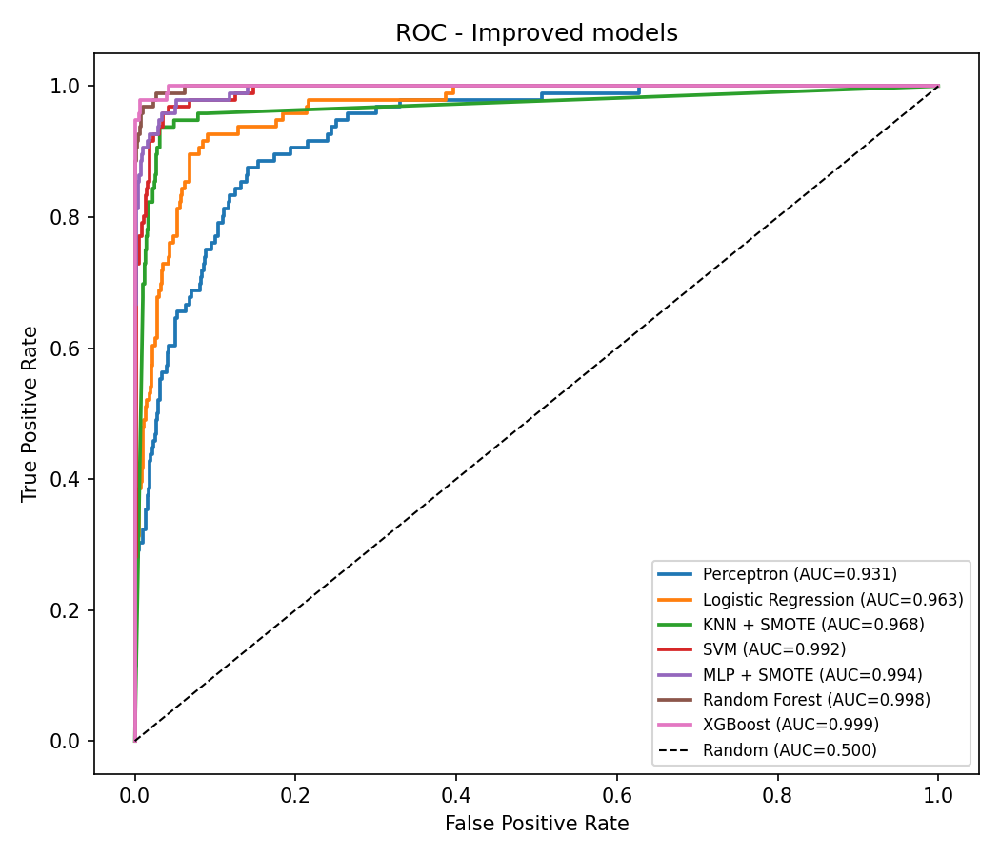

# Predicting Acceptance of Personal Loans

**UE24CS352A – Machine Learning | Mini Project | PES University**

| Name | SRN |
|---|---|
| Mathin M | PES1UG24AM377 |
| Madan P | PES1UG24AM374 |

## Problem statement

Thera Bank wants to convert its liability (deposit) customers into personal-loan customers. In a previous campaign only **9.6%** of the targeted customers accepted the offer. The goal is to build a classifier that predicts whether a customer will **accept a personal loan** (`Personal Loan` = 1/0), so that marketing can target the right customers.

This project replicates the reference paper (*Prediction of Personal Loan Acceptance using Machine Learning*: Perceptron, Logistic Regression, K-Means/KNN, SVM, MLP) and then improves on it with proper scaling, class-imbalance handling, hyper-parameter tuning and tree ensembles.

## Dataset

- **Source:** Kaggle – [Personal Loan Modeling](https://www.kaggle.com/datasets/teertha/personal-loan-modeling) (`Bank_Personal_Loan_Modelling.csv`)
- 5000 customers, 14 columns, no missing values, no duplicates
- Target: `Personal Loan` (480 yes / 4520 no, so the classes are imbalanced)

| Feature | Description |
|---|---|
| Age, Experience | Age and years of professional experience |
| Income | Annual income ($000) |
| Family | Family size (1–4) |
| CCAvg | Avg monthly credit-card spending ($000) |
| Education | 1 = Undergrad, 2 = Graduate, 3 = Advanced/Professional |
| Mortgage | Value of house mortgage ($000) |
| Securities Account, CD Account, Online, CreditCard | Binary flags |
| ID, ZIP Code | Dropped (identifier / noise) |

The CSV is **not committed** (see `.gitignore`). Download it and place it at `data/Bank_Personal_Loan_Modelling.csv`.

## Project structure

```
personal-loan-acceptance-prediction/
├── data/                      # put Bank_Personal_Loan_Modelling.csv here
├── notebooks/
│   └── loan_prediction.ipynb  # EDA → preprocessing → models → results (executed)
├── src/
│   ├── preprocess.py          # load, clean, stratified split, scaling
│   ├── train.py               # trains baseline + improved models, saves best model
│   └── evaluate.py            # metrics, ROC curves, confusion matrices, feature importance
├── app/
│   └── app.py                 # Streamlit demo
├── models/                    # best_model.pkl (generated by train.py)
├── results/
│   ├── figures/               # ROC, confusion matrices, feature importance
│   ├── metrics_baseline.csv
│   ├── metrics_improved.csv
│   ├── metrics_all.csv
│   └── best_params.json
├── report/                    # write-up PDF
├── requirements.txt
└── README.md
```

## Setup and how to run

```bash
# 1. Clone
git clone <repo-url>
cd personal-loan-acceptance-prediction

# 2. Create a virtual environment and install dependencies (Python 3.9+)
python -m venv venv
venv\Scripts\activate          # Windows
# source venv/bin/activate     # Linux / macOS
pip install -r requirements.txt

# 3. Download the dataset from Kaggle and put it in data/
#    data/Bank_Personal_Loan_Modelling.csv
#    (or: kaggle datasets download -d teertha/personal-loan-modeling --unzip -p data)

# 4. Train all models (about 1–2 minutes). This writes results/ and models/best_model.pkl
python src/train.py

# 5. Launch the demo app
streamlit run app/app.py

# (optional) Open the notebook
jupyter notebook notebooks/loan_prediction.ipynb
```

## Approach

1. **EDA:** class balance, distributions by class, acceptance rate per categorical feature, correlation heatmap.
2. **Preprocessing:**
   - Drop `ID` and `ZIP Code`.
   - Clip the 52 negative `Experience` values to 0.
   - Use a stratified 80/20 split.
   - Fit `StandardScaler` on the training data only.
3. **Experiment 1, baseline (paper replication):** Perceptron, Logistic Regression, KNN and linear SVM with default settings on unscaled features; K-Means (k = 2) and MLP (1 hidden layer, 100 neurons) on scaled features. No imbalance handling.
4. **Experiment 2, improved:**
   - Every model is a `Pipeline(StandardScaler → [SMOTE] → classifier)`.
   - Imbalance is handled with `class_weight='balanced'`, `scale_pos_weight` (XGBoost) and SMOTE (KNN and MLP, applied to training folds only).
   - Hyper-parameters are tuned with `GridSearchCV` using 5-fold stratified CV, scoring on F1.
   - Random Forest and XGBoost are added.
   - The best model is selected on **cross-validated F1**, not on the test set.
5. **Evaluation:** accuracy, precision, recall, F1, ROC-AUC, confusion matrices and combined ROC curves. Accuracy alone is misleading here, because predicting "no" for everyone already gives 90.4%.

## Results (held-out test set, 1000 customers, 96 positives)

| Model | Experiment | Precision | Recall | F1 | ROC-AUC |
|---|---|---|---|---|---|
| Perceptron | Baseline | 0.706 | 0.125 | 0.212 | 0.789 |
| Logistic Regression | Baseline | 0.810 | 0.667 | 0.731 | 0.964 |
| KNN | Baseline | 0.508 | 0.323 | 0.395 | 0.876 |
| Linear SVM | Baseline | 0.861 | 0.646 | 0.738 | 0.962 |
| K-Means (k=2) | Baseline | 0.000 | 0.000 | 0.000 | 0.516 |
| MLP (100) | Baseline | 0.919 | 0.948 | 0.933 | 0.996 |
| Perceptron | Improved | 0.427 | 0.823 | 0.562 | 0.931 |
| Logistic Regression | Improved | 0.466 | 0.927 | 0.620 | 0.963 |
| KNN + SMOTE | Improved | 0.720 | 0.938 | 0.815 | 0.968 |
| SVM (RBF) | Improved | 0.788 | 0.927 | 0.852 | 0.992 |
| MLP + SMOTE | Improved | 0.838 | 0.917 | 0.876 | 0.994 |
| Random Forest | Improved | 0.928 | 0.938 | 0.933 | 0.998 |
| **XGBoost** | **Improved** | **0.913** | **0.979** | **0.945** | **0.999** |

**Best model: XGBoost.** It catches 94 of the 96 acceptors with only 9 false alarms.



**Top features (XGBoost):** Income, Family, Education, CCAvg, CD Account.

## Key findings

- Scaling matters for distance and gradient-based models. KNN F1 rose from 0.39 to 0.81, and Perceptron recall rose from 0.13 to 0.82.
- Class weighting pushes the recall of linear models above 0.92 at the cost of precision. That is a sensible trade-off for a marketing campaign, where missing a likely customer costs more than one extra call.
- The decision boundary is non-linear (high income **and** graduate education **and** larger family), so tree ensembles clearly outperform the linear models.
- K-Means is not useful here: its clusters don't line up with loan acceptance (AUC ≈ 0.52).

## Future work

- Tune the probability threshold to the bank's cost trade-off.
- Add SHAP explanations.
- Validate on newer or larger bank data.

## References

1. Reference paper shared by the course faculty: *Prediction of Personal Loan Acceptance using Machine Learning*.
2. Kaggle dataset: https://www.kaggle.com/datasets/teertha/personal-loan-modeling
3. scikit-learn, imbalanced-learn, XGBoost documentation.
